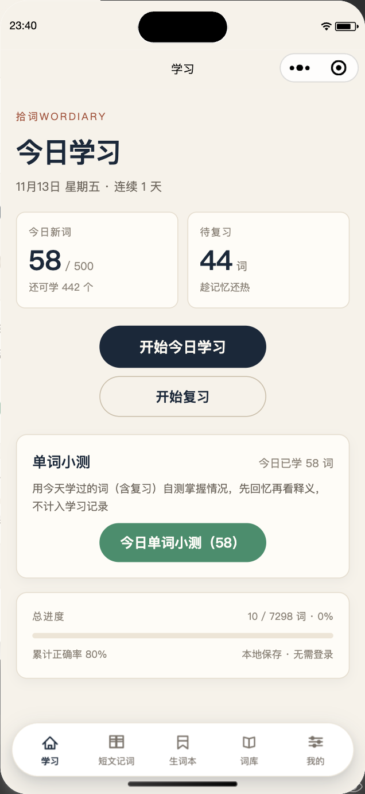
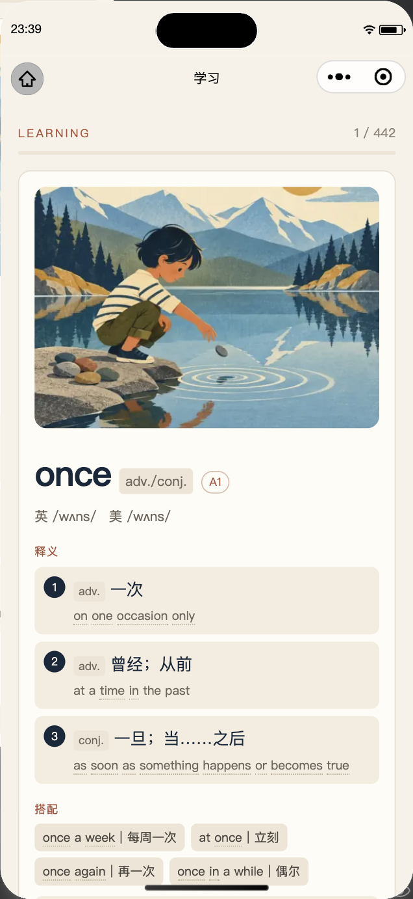
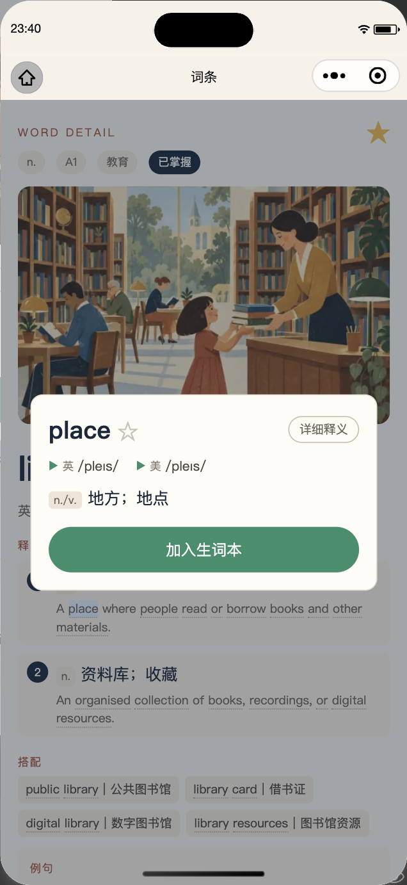
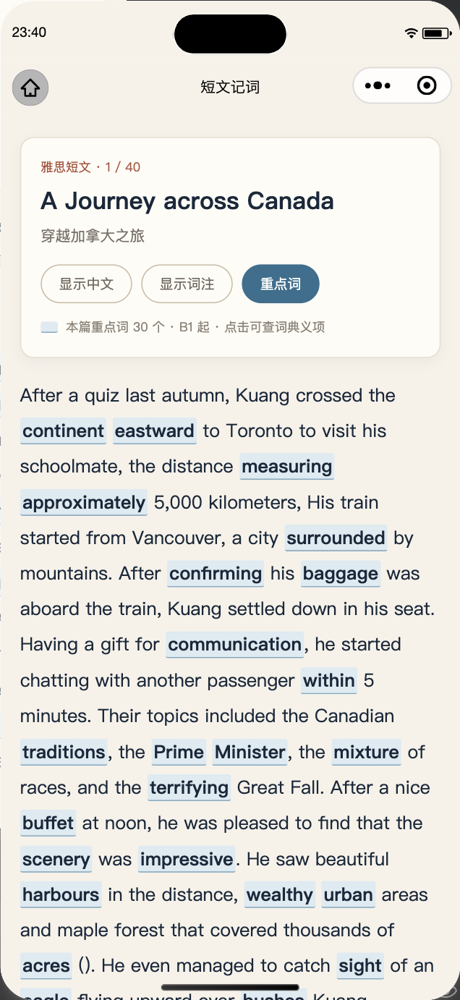
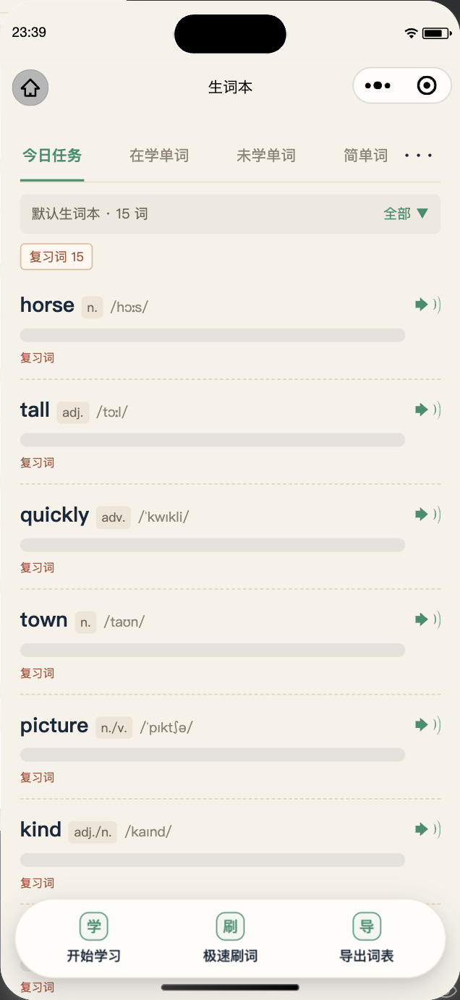
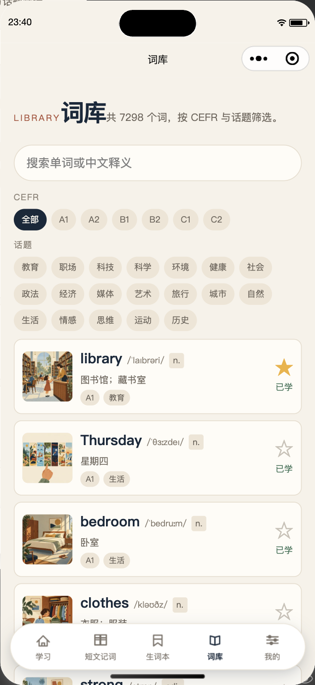
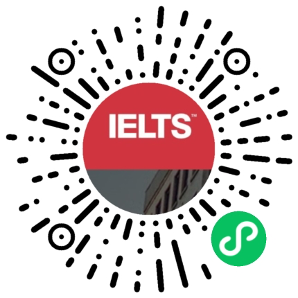

<div align="center">

# Wordiary

**See a word as a picture. Put it back where it belongs — in context.**

7,298 entries · illustrated cards · UK/US audio · FSRS spaced repetition · bilingual passages

[Scan to Open](#scan-to-open) · [Screenshots](#inside-the-mini-program) · [Run Locally](#run-locally) · [Data and Architecture](#data-and-architecture) · [Contributing](#contributing) · [中文](README.md)

[](LICENSE)
[](CONTENT_LICENSE.md)

</div>

---

Wordiary is a lightweight WeChat Mini Program that teaches vocabulary through illustrations and context.

> **About this repository**: This is the complete source of the Wordiary WeChat Mini Program, **actively maintained**. Code and content are licensed separately under [MIT](LICENSE) / [CC BY 4.0](CONTENT_LICENSE.md); the licensing status of the passage texts is described under "Known Limitations".

| Project | |
| :--- | :--- |
| Name | Wordiary |
| Type | Native WeChat Mini Program · TypeScript |
| Vocabulary | 7,298 entries / 19 topics / CEFR A1–C2 |
| Scheduling | FSRS (ts-fsrs) spaced repetition |
| Storage | On-device storage; no accounts, no cloud sync |
| Data source | Word Atlas open dataset (CC BY 4.0) |
| Status | Actively maintained |

[Inside the Mini Program](#inside-the-mini-program) · [Run Locally](#run-locally) · [Data and Architecture](#data-and-architecture) · [Feature Details](#feature-details) · [Local Data and Privacy](#local-data-and-privacy) · [Verification](#verification) · [Known Limitations](#known-limitations) · [Contributing](#contributing) · [License](#license)

## Inside the Mini Program

**What it is**: Look at a picture, listen, actively recall — then let FSRS bring the word back exactly when it is due. And when a whole paragraph of English still feels foggy, open a passage and see the word in use.

### Feature Preview

<table>
<tr>
<td width="50%"></td>
<td width="50%"></td>
</tr>
<tr><td align="center">Today's study, due reviews and the daily quiz</td><td align="center">Illustration, all senses, UK/US audio</td></tr>
<tr>
<td width="50%"></td>
<td width="50%"></td>
</tr>
<tr><td align="center">Tap a word in a sentence for an instant definition</td><td align="center">67 bilingual passages with highlighted words</td></tr>
<tr>
<td width="50%"></td>
<td width="50%"></td>
</tr>
<tr><td align="center">Four-category word list and floating toolbar</td><td align="center">7,298-word library, filters and stars</td></tr>
</table>

<sub>Screenshots from the shipped Mini Program.</sub>

### How You Learn

| Step | What you do |
| :--- | :--- |
| **See** | Illustrated cards with every sense, collocations, examples, word family, synonyms and antonyms. |
| **Hear** | UK / US / example audio, following the accent chosen under "Me". |
| **Recall** | Meaning choice, picture gap-fill, audio choice and spelling; a missed word returns to the end of the round. |
| **Review** | FSRS schedules the next due date from each rating; target retention is adjustable and only the first attempt counts. |
| **Accumulate** | Wordbooks, rapid drill, today's quiz, bilingual passages and topic progress. |

**Local first.** No sign-up; learning records, settings and wordbooks live on the device and can be exported or cleared at any time.

### Highlights

- **Illustrated cards + UK/US audio**: the full 7,298-word library, with all senses, collocations, examples, synonyms and antonyms on one card.
- **FSRS spaced repetition**: the next due date is computed from each rating, not from a fixed calendar.
- **Four active-recall question types**: meaning choice / picture gap-fill / audio choice / spelling, with missed words returning to the end of the round.
- **Wordbooks and rapid drill**: unfamiliar words are collected automatically; study them separately, drill quickly or export a list.
- **Reading passages**: 67 bilingual texts with keywords highlighted automatically by CEFR level; tap one for its definition.
- **Today's quiz**: review only the words you studied today, straight after a study session.

**Use it when**: building IELTS / CET vocabulary; reviewing in spare moments on a commute or in a queue; when every word in a list looks familiar but a full sentence does not; or when you want unfamiliar words kept in one place.

### Scan to Open

<p align="center">
  
</p>

<p align="center"><b>Scan with WeChat, or search "拾词Wordiary"</b><br />No sign-up required; your progress stays on your device</p>

## Run Locally

### Quick Start

```bash
cd 雅思单词项目
npm install
npm run typecheck
```

1. In WeChat DevTools, import this directory (`project.config.json` already sets `miniprogramRoot: miniprogram/`).
2. Run **Build npm** (required). `ts-fsrs` is emitted into `miniprogram/miniprogram_npm/`.
3. Compile. Rebuild npm whenever dependency versions change.
4. Illustrations and audio always come from the cloud static-hosting CDN — DevTools, on-device debugging, the trial build and production all behave the same; no local media server is needed.

### Deployment

- **Environment ID**: `slogan-d2g7bvmyw4f8d901e`; static hosting domain: `https://slogan-d2g7bvmyw4f8d901e-1527547939.tcloudbaseapp.com` (no ICP filing, no Mini Program domain allowlist, anonymous direct links; defined only in `miniprogram/data/media.ts`).
- **First-time setup**:
  1. `npx cloudbase login` to authorize the CLI (the cloud account must belong to the same entity as the Mini Program).
  2. `npm run upload:media` deploys `../word-atlas/public/atlas` to the `atlas/` path (~36,000 files / 700 MB; re-running resumes and overwrites).
- **Direct-link check**: `curl -s -o /dev/null -w "%{http_code}" https://slogan-d2g7bvmyw4f8d901e-1527547939.tcloudbaseapp.com/atlas/thumb/library.webp` should return 200.
- Cloud Storage direct links are not used: public-read on all objects is a paid add-on, whereas static hosting is publicly readable by design and fits within the free tier.
- **Release flow**: upload from DevTools → submit for review in the MP console (category: Education; no login, payments or sensitive permissions) → verify on a real device with the trial build → publish.

> The environment ID and static hosting domain above are public resource addresses, not credentials; the repository contains no keys or tokens.

**Stack**: native WeChat Mini Program · TypeScript · ts-fsrs · cloud static-hosting CDN

## Data and Architecture

### Directory Layout

```
miniprogram/
├─ app.ts / app.json / app.wxss
├─ pages/        home / study / practice / review / library / word-detail / progress / settings
│                wordbook / wordbook-list / wordbook-rush (wordbook pages)
│                passage-list / passage-detail (reading pages)
├─ components/   word-card / audio-button / quiz-option / progress-bar / word-text / word-popup
├─ services/     storage / learning / fsrs / audio / quiz / word-repo / import-export
│                wordbook / word-lookup / passage-repo
├─ store/        lightweight state and persistence
├─ data/         vocab-index (7,298-word index, main package) / vocab-chunks / vocab-chunk-loaders
│                media (CDN derivation) / topics / passages (texts and keyword marks, main package)
├─ vocab-a~d/    4 data-only subpackages (plain CommonJS chunks loaded via require.async)
├─ assets/tab/   tabBar icons (gen-tab-icons.py / gen-wordbook-icon.mjs / gen-passage-icon.mjs)
├─ types/        PRD data model + passage types
└─ utils/        date helpers
```

`docs/images/` holds the QR code and screenshots referenced by the READMEs. The requirements document `docs/PRD.md` lives at the workspace root, outside this repository.

### Vocabulary and Passage Data

- **7,298 entries**: the main-package index `data/vocab-index.ts` holds 8-tuples (id, word, first Chinese sense, UK/US IPA, CEFR, topic, part of speech). Details are split into 500-word chunks across the `vocab-a`–`vocab-d` data subpackages; each detail row is `[id, senses, examples, collocations, wordFamily, usageTip, synonyms, antonyms, note]`, with `senses = [[pos, zh, en], ...]` and `examples = [[en, zh], ...]` (the UI renders only the first example).
- `services/word-repo.ts` loads chunks on demand through `require.async`, caches them, and merges them into the PRD `Word`. The original fields `meaningEN/example/exampleCN` still take the first sense and first example (so quiz prompts and the library list stay unchanged), while `senses/examples/synonyms/antonyms/note` carry the full definitions shown on cards and detail pages.
- **Subpackage paths must be string literals**: `data/vocab-chunk-loaders.ts` (generated by `build-vocab.mjs`) writes one literal `require.async('../vocab-x/chunks/N.js')` per chunk. A template string hides those 15 files from DevTools' static dependency analysis, so they are flagged as unused — filtered out on upload if `ignoreUploadUnusedFiles` is `true`, or bundled into the upload and failing the "no unused files" quality check if it is `false`. Both project configs therefore keep `ignoreDevUnusedFiles` / `ignoreUploadUnusedFiles` at `true`; `project.private.config.json` takes precedence and is git-ignored, so re-check it when importing the project on another machine.
- Build the vocabulary with `npm run build:vocab` (`scripts/build-vocab.mjs`, reading upstream `word-atlas/data/word-atlas.json`; asserts entry count, id uniqueness, subpackage size and `app.json` subpackage registration). Changing detail volume changes the number of subpackages — follow the script's hint and sync `app.json`'s `subPackages`.
- **Passage data**: `npm run build:passages` (`scripts/build-passages.mjs`) reads `../wordiary-passages/passages.min.json`, cross-checks it against `passages.json`, and generates `miniprogram/data/passages.ts` in the main package (~533 KB). Output contains 67 entries, segmented English text, segmented Chinese translation and keyword marks, with assertions for count, unique ids, non-empty text, JSON parity, segment reconstruction and mark positions. **Re-run this after any passage data change**; never hand-edit generated files.
- **Keyword rules**: keywords, Chinese glosses, CEFR levels and IPA all come from the 7,298-word Word Atlas index (CC BY 4.0). Content words matching the index (with light lemmatisation) at CEFR ≥ B1 are marked; a passage with too few drops to A2, one that is too dense rises to B2, and multi-word headwords are marked as a whole. 1,712 marks in total, 3–48 per passage. A dictionary sense may not match the context, so the popup warns about this and shows every sense.
- Media URLs are derived at runtime (`data/media.ts`): every environment uses `https://slogan-d2g7bvmyw4f8d901e-1527547939.tcloudbaseapp.com/atlas/...`. Do not switch between local and cloud by `envVersion` — on-device debugging is also `develop`, where `127.0.0.1` points at the phone itself and all media would fail. Failed images/audio fall back to a local placeholder and retry without blocking study.
- Entries, illustrations and audio come from the Word Atlas open dataset (CC BY 4.0). **The 67 passage texts/translations were collected from online sources with unclear licensing; confirm the rights or replace them before any public release** — see "Known Limitations".

## Feature Details

### Navigation and Pages

- **5 tabs**: Study / **Reading Passages** / Wordbook / Library / Me. WeChat allows at most 5 `tabBar.list` entries, so Progress was demoted to a "Topic Progress" secondary entry inside Me (`wx.navigateTo`); `pages/progress/progress` is still registered as a normal page and still uses `switchTab` to reach the library.
- **Floating tabBar**: the native tabBar is rendered by the client and cannot have rounded corners, shadows or floating margins, so `tabBar.custom: true` plus `miniprogram/custom-tab-bar/` provides a white pill with a soft double shadow and 5 icon/label items, navigating with `wx.switchTab`. `tabBar.list` is still required to declare tab pages; each tab page calls `utils/tabbar.ts#syncTabBar` in `onShow`, and all five add `padding-bottom: 180rpx` so the pill does not cover content. The existing 10 PNG icons are reused.

### Learning Loop

- Study → four question types (meaning choice, picture gap-fill, audio choice, spelling) → FSRS review.
- Four review grades: Again / Hard / Good / Easy; the grade is written to `fsrsCard` and persisted locally.
- Settings cover daily new-word count, target retention, accent preference, JSON export / import / clear, and the "Topic Progress" entry.

### Word Cards and Definitions

- Cards and detail pages expand the full definition in this order: all senses (POS + Chinese/English) → collocations → one example → word family → synonyms → antonyms → usage notes. The English example is always visible, its Chinese translation follows the "Show meaning" toggle, and library lists / quiz prompts keep the short first sense. **Every word view (study / review / detail / rapid drill) shows only the first example**, while the data keeps them all.
- **Tap-a-word popup**: English words inside example sentences, collocations, word families, synonyms/antonyms and usage notes are tokenised by `services/word-lookup.ts` and looked up in the main-package index. **Only words present in the library (with light lemmatisation, e.g. `endured → endure`) are tappable** (faint dashed underline); tapping opens a light warm-beige card with the word, star, UK/US IPA and audio, a short definition, an in-card "Full definition" expansion with every sense and one example, and "Add to wordbook". Words not in the library (function words, derivations) stay plain text with no tap or popup; there is no "Ask AI" search box. The popup renders through `root-portal` at the page root, above the invisible left/right tap zones (`z-index:2`) and the first-run guide (`z-index:3`); quiz prompts, library rows and wordbook lists do not use it. About 71% of English word occurrences are tappable.
- **Today's quiz**: a dedicated "Quiz" card on the Study tab (showing how many words you studied today) and an entry on the study completion page both open `wordbook-rush?source=today`, **reusing every rapid-drill interaction** (recall before revealing, known / unknown, restart, converging the unknown words into a new round, tap-a-word popups). Only the data source and back behaviour change. `services/learning.ts#getTodayStudiedWordIds()` looks up words first seen or studied/reviewed today in `LearningRecord`, ordered by the library's learning path — distinct from the "today's pending pool" `getTodayNewWordIds()`. The button is disabled when nothing was studied today. The completion page offers "Restart / Unknown words (N) / Back to home", returning via `switchTab`. Like rapid drill, it **does not write AppData or FSRS and does not affect accuracy**.

### Wordbook

- **Wordbooks** are shown as a flat list, each with "Word list" and "Start studying". One undeletable "Default wordbook" exists initially; others can be created, renamed and deleted, and any book can be made the default (exactly one, marked on its card). Rating "Unknown" while studying, "Again" while reviewing, or missing the same word twice in a quiz automatically adds the word (deduplicated) to the current default book. Cards also support **swipe-left to delete**: a red Delete button appears, with a confirmation dialog; deleting removes the book and its word list but leaves learning records untouched. The fixed book `id='default'` cannot be deleted and shows a hint instead; the delete option in the edit dialog remains.
- **Library stars**: library rows and word detail pages have a star — hollow grey for not saved, solid yellow for saved to the default wordbook — toggled on tap.
- **Audio**: the speaker in word lists and rapid drill follows the accent set under "Me" in real time (`audio/uk` / `audio/us`); `services/audio.ts` calls `stop()` and reassigns `src` on every play, because iOS silently fails when `play()` is called again on the same `src` after `onEnded`.
- **Word list page**: four tabs map to existing learning state (Today = due or pending, capped by the daily goal; Studying = learning/review; Unlearned = new/no record; Easy = mastered), with a CEFR filter, a "due only" filter, tap-to-reveal and accent-aware audio. The top-right menu sets the daily goal, removes or adds words (full-library search), clears the list, and switches between three masking modes (none / hide definitions / hide words).
- **"Start studying" reuses** `pages/study/study` (`?wordbook=<id>` selects today's words from that book) with exactly the same rating, FSRS, auto-audio, invisible tap zones and end-of-round quiz as normal study. When the source is a wordbook, the completion and quiz-result pages show "Back to word list", which returns to that book's list (switch to the Wordbook tab, then open the list, keeping the page stack clean); normal study still shows "Back to home" plus `navigateBack`. The floating toolbar also offers "Rapid drill" (all senses, one example, collocations / word family / synonyms / antonyms / usage notes; fast browsing that writes no FSRS or learning records; the completion page can collect the words still unknown into a fresh round and repeat until none remain, while "Restart" returns to the full list) and "Export list" (readable text to the clipboard). "AI passage fill-in" from the reference mockups is not implemented.

### Reading Passages

- `passage-list` is a tab page with two groups — 40 IELTS passages and 27 bilingual stories — showing bilingual titles and each passage's keyword count. `passage-detail?id=<id>` shows the full English text (keywords highlighted in pale blue and underlined) plus the Chinese translation. Three toggles: **Show Chinese** (whole translation, off by default), **Show glosses** (inline Chinese after each keyword, off by default) and **Keywords** (master highlight switch, on by default). Tapping a keyword opens a warm-beige card with the headword, CEFR level, UK/US IPA and dictionary senses. "Previous / Next" stays within the current group, using `redirectTo` to replace the top of the stack and preserving toggle state across pages; entering from the list resets to defaults. **Passages write no AppData or FSRS, record no read state, and have no audio, wordbook adding, search or sentence-by-sentence view.**

### Library and Progress

- The library supports CEFR and topic filters plus keyword search across the full 7,298-word index; the progress page shows per-topic bars that link back to a filtered library.

### Interaction and Layout

- UK / US / example audio share one large segmented control on study, review and detail pages (`app.wxss` `.audio-group` + the `grouped` property of `audio-button`). Buttons use a `view` with a nested `text` for exact centring, and the pressed/playing state is drawn by an inner `.audio-highlight` as a fully rounded pill inset on all sides rather than being clipped into rectangles; the quiz page keeps a single standalone capsule. The three detail-page buttons and the post-rating "Hide meaning / Next" pair are laid out in one row.
- Quick review grading is fixed left-to-right as "Unknown / Unsure / Known", with the dark primary action on the right for one-handed use.
- The three detail-page buttons are fixed as "Add to today / Mark learned / Next word", again with the dark primary action on the right.
- **First-run guide**: on first entering a study/review card, two transparent rounded rectangles with dashed borders mark the tap zones, containing only the vertical hints "Unknown" / "Known" — no centre panel. Tapping a box performs the corresponding rating and closes the guide; tapping elsewhere only closes it. A standalone local flag is then written (`word-atlas:tap-zone-hint:v1`, outside `AppData` and excluded from import/export). In normal use the left/right tap zones are completely invisible.
- The invisible zones always mirror the visible buttons: before rating, right = Known and left = Unknown; after "Unknown" reveals the definition (and the "Hide meaning / Next" pair appears), right = Next and left = toggle meaning. The four-grade review state does not use tap zones.
- The word detail page has its own zones: right = Next word, left = Mark learned, equivalent to the bottom buttons, with its own one-time dashed guide ("Mark learned / Next word") and an independent flag `word-atlas:detail-zone-hint:v1`.

## Local Data and Privacy

### Local Storage

- Storage key: `word-atlas:appdata:v1` (`wx.setStorageSync`), holding `settings / records / stats / wordbooks`. `wordbooks` is optional; `validateAppData` normalises every field (names, word deduplication, goal 1–500, masking enum) and guarantees the fixed book exists in first position; an invalid `defaultWordbookId` falls back to the first book. Importing a `version === 1` backup without `wordbooks` adds the default book without touching other data. The two first-run guide flags are separate keys, excluded from import/export.
- Export writes the full `AppData` JSON to the clipboard; import validates `version === 1`, setting ranges, records and FSRS card fields, refuses invalid data, and asks for confirmation before overwriting.

### Security and Privacy

- **No accounts, no cloud sync**: no phone number, location or contacts are collected; records, settings and wordbooks stay in on-device storage and can be exported or cleared at any time.
- **No credentials in the repository**: no AppSecret, tokens, private keys or `.env` files; the DevTools private config is excluded by `.gitignore` and never committed.
- **Public identifiers**: the AppID in `project.config.json` and the static hosting domain are public resource identifiers, not credentials; media is fetched through anonymous direct links with no authentication.
- **Data compliance**: attribution for entries and media is under "License"; the licensing status of passage texts is under "Known Limitations".

## Verification

```bash
npm run typecheck        # exit code 0
npm run build:passages   # re-run after passage data changes: 67 texts / segments / marks
npm run selfcheck:lookup # full tap-a-word index check: lossless tokenisation, hit rate, id lookup
npm run e2e              # requires DevTools running (CLI auto-detected)
```

`scripts/e2e-verify.mjs` drives WeChat DevTools through `miniprogram-automator`: static checks for the 5-tab order and Progress demotion; cross-subpackage entries, full detail fields, study cards, the 7,298-row library, reachable image URLs, invisible tap zones and the first-run guide across three pages; wordbook cases (default book, create/rename, four categories, masking, adding words, reusing the study page, rapid drill), convergence rounds and regression checks; tap-a-word popups, today's quiz; and the **14th group for reading passages** (40/27 groups, catalogue counts, Chinese hidden by default, keyword and gloss toggles, popups, in-group paging, the Progress entry in Me), with no module errors in the console. Setting `E2E_SCREENSHOT=/tmp/shot.png` adds detail, card, wordbook, popup, home-quiz and passage screenshots from the same connection (`-passage-list.png` / `-passage-detail.png` / `-passage-gloss.png`, etc.) for visual review; a second DevTools launch tends to fail, so all screenshots must come from one run.

The Wordbook tab icon is generated by `npm run gen:wordbook-icon` and the Reading icon by `npm run gen:passage-icon` (both pure Node, no Pillow); the remaining icons use `npm run gen:tab-icons` (requires Pillow).

Manual DevTools walkthrough: Home → Study → Quiz (four types) → Review → Reading (groups, glosses, paging) → Library filters/search/detail → Me → Topic progress → Settings export/clear/import → restart the simulator and confirm data persists.

> E2E needs WeChat DevTools running. The script auto-detects the official install location per platform, so no configuration is needed; set `WECHAT_DEVTOOLS_CLI` to override a custom install. No machine-specific path is hardcoded in the repository.

## Known Limitations

- Initial FSRS learning steps are 1 minute / 10 minutes so that a due queue can be demonstrated quickly; adjust them in `services/fsrs.ts`.
- On a real device, cloud CDN media is available only in the trial or production build; DevTools on-device preview cannot load it (local `127.0.0.1` is unreachable).
- Compiling, building npm and on-device audio playback in WeChat DevTools cannot be fully replaced by the CLI — confirm them manually as described above.
- **Passage licensing**: the 67 passage texts/translations were collected from online sources, some adapted from Chinese high-school textbooks and bilingual readers. Personal study is unaffected, but **confirm the rights or replace the material before any public release**.
- **Passage data quality**: 27 bilingual stories contain run-together words and 13 are serialised parts (1)/(2) that may be incomplete; the original glossary covers only the first 4 passages, so keywords are derived from the 7,298-word library by CEFR level and may not match the textbook's notes — proofread before release.
- Main-package source is about 1.5 MiB (`data/passages.ts` ~533 KB), close to the 2 MiB limit; further passage data should be split into data-only subpackages the way `data/vocab-chunk-loaders.ts` does.

## Contributing

When reporting an issue, please include the **entry ID, reproduction steps and expected result**. For content corrections, cite a dictionary or another reliable source.

- **Report an issue**: open a repository Issue for entry errors, UI problems or suggestions.
- [Contributing guide](CONTRIBUTING.md): data sync, code conventions and pre-commit checks.
- [Security policy](SECURITY.md): how to report security issues.

## License

| Scope | License |
| :--- | :--- |
| Application code | [MIT](LICENSE) |
| Vocabulary text, illustrations and word audio | [CC BY 4.0](CONTENT_LICENSE.md), attributed to Word Atlas contributors (词光) |
| Third-party dependencies and fonts | Their respective licenses; see the corresponding files |

---

Made by [@AnsenC01](https://github.com/AnsenC01). Vocabulary entries, illustrations and audio come from [Word Atlas](https://github.com/0xlei/word-atlas) (CC BY 4.0).

If Wordiary is useful to you, consider starring the repo or sharing it with a friend who is learning English.
