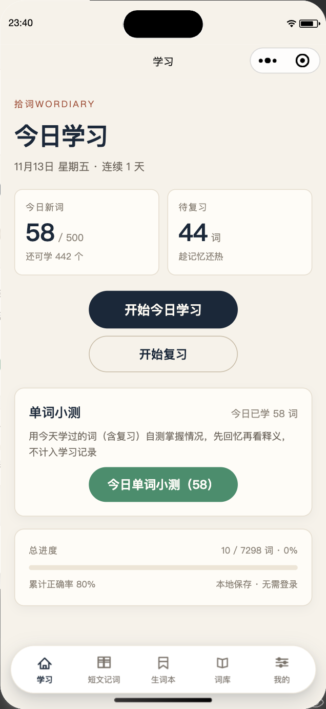
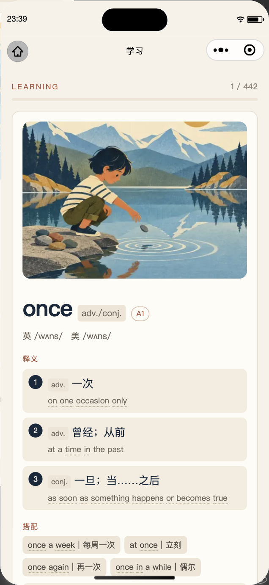
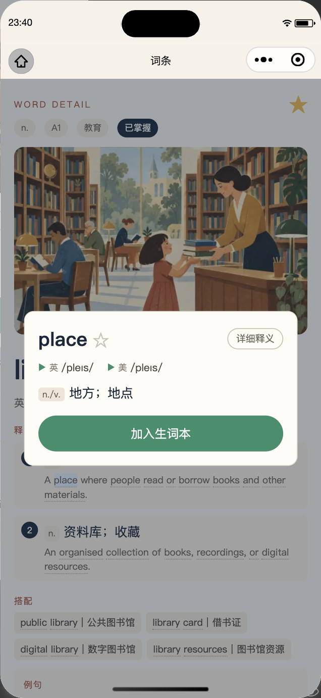
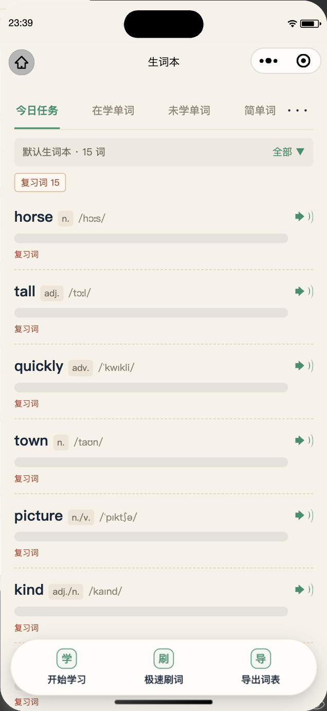
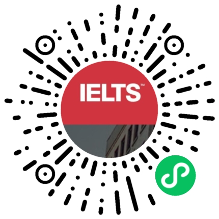

<div align="center">

# 拾词Wordiary

**看图背单词，把词放回语境里。不要求你坚持，只负责让词回来。**

7,298 词 · 插画词卡 · 英美发音 · FSRS 间隔复习 · 双语短文

[微信扫码](#扫码体验) · [功能预览](#小程序体验) · [本地运行](#本地运行) · [数据与架构](#数据与架构) · [参与贡献](#参与贡献) · [English](README.en.md)

[](LICENSE)
[](CONTENT_LICENSE.md)

</div>

---

拾词Wordiary 是一款以插画和语境为核心的轻量背词小程序。

> **版本说明**：本仓库为拾词Wordiary 微信小程序的完整代码，**持续维护中**。代码与内容分别遵循下方的 [MIT](LICENSE) / [CC BY 4.0](CONTENT_LICENSE.md) 授权；短文原文/译文的授权状态见「已知限制」。

| 项目信息 |                             |
| :--- | :-------------------------- |
| 产品名称 | 拾词Wordiary                  |
| 项目类型 | 微信原生小程序 · TypeScript        |
| 词库规模 | 7298 词 / 19 话题 / CEFR A1–C2 |
| 复习调度 | FSRS（ts-fsrs）间隔复习           |
| 数据存储 | 本机 Storage，无账号、无云同步         |
| 数据来源 | Word Atlas 开源数据集（CC BY 4.0） |
| 维护状态 | 持续维护                        |

[小程序体验](#小程序体验) · [本地运行](#本地运行) · [数据与架构](#数据与架构) · [功能说明](#功能说明) · [本地数据与安全](#本地数据与安全) · [验收自检](#验收自检) · [已知限制](#已知限制) · [参与贡献](#参与贡献) · [授权](#授权)

## 小程序体验

**定位**：看图、听音、主动回忆，再用 FSRS 把该复习的词按时送回来；读完一整段英文发懵时，还能进短文里看词怎么用。

### 功能预览

<table>
<tr>
<td width="50%"></td>
<td width="50%"></td>
</tr>
<tr><td align="center">今日学习、待复习与单词小测</td><td align="center">插画、全义项、英美发音</td></tr>
<tr>
<td width="50%"></td>
<td width="50%"></td>
</tr>
<tr><td align="center">例句点词，弹出释义小卡</td><td align="center">67 篇双语材料与重点词</td></tr>
<tr>
<td width="50%"></td>
<td width="50%"></td>
</tr>
<tr><td align="center">四分类词表与浮动工具条</td><td align="center">7298 词筛选与星标收藏</td></tr>
</table>

<sub>以上为小程序最终版实际界面截图。</sub>

### 学习方式

| 环节 | 你会做什么 |
| :--- | :--- |
| **看见** | 插画词卡、全部义项、搭配、例句、词族与同反义词，一次看全。 |
| **听见** | 英音 / 美音 / 例句朗读，跟随「我的」中的发音偏好。 |
| **想起** | 看义选词、看图补句、听音辨词、拼写；答错的词回到本轮末尾。 |
| **复习** | FSRS 按每次评分安排下次到期时间，目标记忆率可调，仅首答计入正确率。 |
| **积累** | 生词本、极速刷词、今日小测、双语短文与话题进度。 |

**本地优先。** 无需注册登录；学习记录、设置与生词本保存在设备本地，可随时导出或清除。

### 核心亮点

- **插画词卡 + 英美双发音**：7298 词全量词库，全义项、搭配、例句、同反义词一次看全。
- **FSRS 间隔复习**：按每次评分动态计算下次到期时间，而不是按日历。
- **四种主动回忆题型**：看义选词 / 看图补句 / 听音辨词 / 拼写，答错的词回到本轮末尾。
- **生词本与极速刷词**：不认识的词自动收集，可单独学习、快速过词、导出词表。
- **短文记词**：67 篇双语材料，重点词按 CEFR 自动标出，点词即看释义。
- **今日单词小测**：只测今天学过的词，学完立刻自检。

**使用场景**：备考雅思 / 四六级积累词汇；通勤、排队等碎片时间复习；想摆脱「单词表都眼熟、连成句子就发懵」；需要把生词集中管理。

### 扫码体验

<p align="center">
  
</p>

<p align="center"><b>微信扫一扫，或搜索「拾词Wordiary」即可打开</b><br />无需注册登录，学习记录仅保存在本机</p>

## 本地运行

### 快速开始

```bash
cd 雅思单词项目
npm install
npm run typecheck
```

1. 微信开发者工具 → 导入项目 → 选择本目录（`project.config.json` 已配置 `miniprogramRoot: miniprogram/`）。
2. 工具 → **构建 npm**（必须）。`ts-fsrs` 会被输出到 `miniprogram/miniprogram_npm/`。
3. 点击编译。若更换依赖版本，需要重新构建 npm。
4. 媒体（插画/音频）统一走云开发静态托管 CDN，开发者工具、真机调试、体验版、正式版行为一致，无需本地媒体服务。

### 上线配置

- **环境 ID**：`slogan-d2g7bvmyw4f8d901e`；静态托管域名：`https://slogan-d2g7bvmyw4f8d901e-1527547939.tcloudbaseapp.com`（免备案、免小程序域名白名单、匿名可直链，写在 `miniprogram/data/media.ts`，仅此一处）。
- **首次准备**：
  1. `npx cloudbase login` 完成 CLI 授权（腾讯云账号，须与小程序同一主体）。
  2. `npm run upload:media`：将 `../word-atlas/public/atlas` 部署至静态托管 `atlas/` 目录（约 3.6 万文件 / 700MB，中断后重跑可覆盖续传）。
- **直链验证**：`curl -s -o /dev/null -w "%{http_code}" https://slogan-d2g7bvmyw4f8d901e-1527547939.tcloudbaseapp.com/atlas/thumb/library.webp` 应为 200。
- 说明：不使用云存储直链方案——「所有用户可读」权限属于付费套餐增值能力，而静态托管资源天然公开可访问，免费额度即可满足。
- **发布流程**：开发者工具上传代码 → mp 后台提交审核（类目：教育；无登录/支付/敏感权限）→ 体验版真机验收 → 发布。

> 上述环境 ID 与静态托管域名是公开资源地址，不是访问凭据；仓库内不含任何密钥或令牌。

**技术栈**：微信原生小程序 · TypeScript · ts-fsrs · 云开发静态托管 CDN

## 数据与架构

### 目录结构

```
miniprogram/
├─ app.ts / app.json / app.wxss
├─ pages/        home / study / practice / review / library / word-detail / progress / settings
│                wordbook / wordbook-list / wordbook-rush（生词本三个页面）
│                passage-list / passage-detail（短文记词两个页面）
├─ components/   word-card / audio-button / quiz-option / progress-bar / word-text / word-popup
├─ services/     storage / learning / fsrs / audio / quiz / word-repo / import-export
│                wordbook / word-lookup / passage-repo
├─ store/        轻量状态与持久化
├─ data/         vocab-index（7298 词索引，主包）/ vocab-chunks / vocab-chunk-loaders
│                media（CDN 派生）/ topics / passages（短文与重点词标注，主包）
├─ vocab-a~d/    4 个词条详情数据分包（原生 CommonJS chunk，require.async 按需加载）
├─ assets/tab/   tabBar 线描图标（gen-tab-icons.py / gen-wordbook-icon.mjs / gen-passage-icon.mjs）
├─ types/        PRD 数据模型 + passage（短文）
└─ utils/        日期工具
```

`docs/images/` 存放 README 引用的小程序码等展示资源；需求文档 `docs/PRD.md` 位于工程根目录（本仓库外）。

### 词库与短文数据

- 全量词库 7298 词：索引（id/词/首义项中文/英美音标/CEFR/话题/词性，8 元组）在主包 `data/vocab-index.ts`；详情按 500 词/chunk 存于 `vocab-a`~`vocab-d` 四个数据分包，详情行为 `[id, senses, examples, collocations, wordFamily, usageTip, synonyms, antonyms, note]`，`senses = [[pos, zh, en], ...]`（全部义项）、`examples = [[en, zh], ...]`（全部例句文本，界面只渲染第一条）。
- `services/word-repo.ts` 经 `require.async` 按需加载并缓存，合并为 PRD `Word`：既有字段 `meaningEN/example/exampleCN` 取首义项、首例句（保证 quiz 题干、词库列表行为不变），新增字段 `senses/examples/synonyms/antonyms/note` 承载完整释义，由词卡/详情页展开。
- **分包依赖必须用字面量路径**：`data/vocab-chunk-loaders.ts`（由 `build-vocab.mjs` 生成）为每个 chunk 写死一条 `require.async('../vocab-x/chunks/N.js')`。若用模板字符串拼路径，开发者工具的静态依赖分析看不到这 15 个数据分包，会把它们判为「无依赖文件」；此时若 `ignoreUploadUnusedFiles` 为 `true` 上传就会过滤掉它们导致真机词条详情空白，若为 `false` 则所有无依赖文件都被打进上传包、代码质量检查「不应存在无依赖文件」不通过。因此两份 project 配置的 `ignoreDevUnusedFiles` / `ignoreUploadUnusedFiles` 保持 `true`；`project.private.config.json` 优先级更高且被 `.gitignore` 忽略，换机器或重新导入项目后要确认它也是 `true`。
- 词库构建：`npm run build:vocab`（`scripts/build-vocab.mjs`，从上游 `word-atlas/data/word-atlas.json` 生成，内置词条数/唯一性/分包体积/`app.json` 分包注册一致性断言）。详情数据量变化会改变分包个数，重跑后需按脚本提示同步 `app.json` 的 `subPackages`。
- **短文数据**：`npm run build:passages`（`scripts/build-passages.mjs`）读取工程外的 `../wordiary-passages/passages.min.json`，与 `../wordiary-passages/passages.json` 逐篇核对中文与英文后，生成 `miniprogram/data/passages.ts`（主包，约 533KB）。产物含 67 篇目录、英文正文分段、中文译文分段与重点词标注；内置 67 篇 / id 唯一 / 中英非空 / 两份 JSON 一致 / 分段还原 / 标注位置与区间校验。**改动短文数据后必须重跑该命令**，不要手改生成文件。
- **重点词口径**：重点词、中文释义、CEFR、英美音标全部来自 Word Atlas 7298 词索引（CC BY 4.0），与预览一致——取命中词库（含轻量词形还原）且 CEFR ≥ B1 的实词，每篇太少降 A2、太密升 B2，词库多词词头优先整体标注；共 1712 处，单篇 3–48 个。词典义项可能与文中语境不完全一致，弹卡已提示并给出全部义项。
- 媒体 URL 运行时派生（`data/media.ts`）：所有环境统一走 `https://slogan-d2g7bvmyw4f8d901e-1527547939.tcloudbaseapp.com/atlas/...`（云开发静态托管 CDN）。不能按 envVersion 区分本地/云端——真机调试同为 develop 环境，`127.0.0.1` 在手机上不可达会导致媒体全部失败。图片/音频失败降级为本地占位图与重试，不阻塞学习。
- 词条内容与插画、发音素材来自 Word Atlas 开源数据集（CC BY 4.0）。**短文原文/译文来自网络流传资料，授权方不明，上架前必须确认授权或替换为自有语料**；详见「已知限制」。

## 功能说明

### 导航与页面

- 5 个 Tab：学习 / **短文记词** / 生词本 / 词库 / 我的。微信 `tabBar.list` 最多 5 项，为插入「短文记词」，原「进度」已降级为「我的」页内的「查看话题进度」二级入口（`wx.navigateTo`）；`pages/progress/progress` 仍注册为普通页面，其跳转词库仍走 `switchTab`。
- **悬浮 tabBar**：原生 tabBar 由客户端渲染，无法设置圆角/阴影/悬浮留白，已启用 `tabBar.custom: true` + `miniprogram/custom-tab-bar/` 组件（白色药丸 + 双层柔和阴影 + 5 项图标/文字，点击走 `wx.switchTab`）。`tabBar.list` 仍保留用于声明 tab 页；5 个 tab 页 `onShow` 通过 `utils/tabbar.ts#syncTabBar` 同步选中态，各页 wxss 加 `padding-bottom: 180rpx` 避免胶囊遮挡内容。图标沿用现有 10 枚 PNG。

### 学习闭环

- 学习 → 四种题型（看义选词、看图补句、听音辨词、拼写）→ FSRS 复习。
- 复习四档评分：忘记 / 困难 / 良好 / 容易；评分写入 `fsrsCard` 并本地持久化。
- 设置支持每日新词数、目标记忆率、发音偏好、JSON 导出 / 导入 / 清除，以及「查看话题进度」入口。

### 词卡与释义

- 词卡/详情页展开完整释义，顺序为：全部义项（词性 + 中英）→ 搭配 → 一条例句 → 词族 → 同义词 → 反义词 → 辨析与用法注意；例句英文常驻、中文译文随「显示释义」显隐，词库列表与练习题干仍用精简首义项。**所有单词界面（学习 / 复习 / 词条详情 / 极速刷词）例句统一只展示第一条**，词库数据仍保留全部例句文本。
- **点词弹卡**：词卡 / 详情页 / 极速刷词的例句英文、搭配、词族、同反义词、义项英文与辨析提示中的英文词，由 `services/word-lookup.ts` 分词后查 7298 词主包索引；**只有命中词库（含轻量词形还原，如 `endured → endure`）的词可点**（淡虚线下划线），点击弹出暖米浅色小卡：单词 / 星标 / 英美音标与发音 / 简单释义 / 「详细释义」卡内原地展开全部义项与一条例句 / 「加入生词本」按钮。未收录词（功能词、派生词等）为普通文字，不响应点击、不弹卡；不做「问 AI」搜索框。弹层用 `root-portal` 渲染到页面根，避开左右隐形热区（`z-index:2`）与首次引导层（`z-index:3`）；练习页题干、词库列表、词表页不接入。据全量实测约 71% 的英文词次可点。
- **今日单词小测**：首页「学习」tab 有独立的「单词小测」卡片（显示今日已学词数），学习完成页也有入口；两者都进入 `wordbook-rush?source=today`，**复用极速刷词的全部交互**（先回忆再看释义、认识 / 不认识、`再刷一轮`、把本轮不认识的词收敛成「本轮生词」反复再刷、点词弹卡），只换数据源与返回行为。取词由 `services/learning.ts` 的 `getTodayStudiedWordIds()` 从 `LearningRecord` 反查今天首次接触或今天学习 / 复习过的词（按词库学习路径排序），与「今日待学池」`getTodayNewWordIds()` 区分开；今天没学过词时按钮置灰。完成页按钮为「再刷一轮 / 本轮生词（N） / 返回首页」，返回用 `switchTab` 回学习 tab。与极速刷词一致，**不写入 AppData / FSRS、不影响正确率**。

### 生词本

- **生词本**：所有本子平铺展示，每本各有「词表」「开始学习」；初始只有一个不可删除的「默认生词本」，可新建 / 重命名 / 删除其它本子，并在编辑弹层里把任意一个本「设为默认生词本」（同时只有一个默认本，卡片带「默认」标记）。学习页评「不认识」、复习页评「忘记」、练习中同一词累计答错 ≥2 次时，自动把词收进当前默认本（去重）。本子卡片支持**左滑删除**：左滑露出红色「删除」按钮，点击弹出二次警告，确认后删除整本（词条一并移除、学习记录不受影响）；固定本 `id='default'` 不可删除，左滑时给出提示；编辑弹层里的删除入口保留。
- **词库五角星**：词库列表项与词条详情页右上角都有五角星，空心灰＝未加入、黄色实心＝已加入默认生词本；点击可加入 / 移出（即时光标状态更新）。
- **发音**：词表行喇叭与极速刷词的「播放发音」实时跟随「我的」中的发音偏好（英音 `audio/uk`、美音 `audio/us`）；`services/audio.ts` 每次播放都会 `stop()` 并重新赋 `src`，避免 iOS 真机在同一音频 `onEnded` 后重复 `play()` 静默失败。
- **词表页**：四个分类 tab 按现有学习状态映射（今日任务＝到期或待学、按任务量取前 N；在学单词＝learning/review；未学单词＝new/无记录；简单词＝mastered）；支持 CEFR「全部 ▼」筛选、复习词筛选、点行临时揭示、跟随发音偏好的单词发音。右上角菜单含设置任务量、移除生词、添加生词（全库搜索）、一键清空，以及不遮挡／遮挡释义／遮挡单词三态；点词条行可临时揭示。
- **生词本的「开始学习」**&#x590D;用 `pages/study/study`（`?wordbook=<id>` 取本内今日任务词），评分、FSRS、自动发音、隐形热区与本轮小测与普通学习完全一致；来源为生词本时，学习完成页与小测结果页的返回按钮为「返回生词列表」，点击跳回该生词本的词表页（先回生词本 tab 再打开词表页，保持页面栈干净）；普通来源仍是「返回首页」+ navigateBack。底部工具条另有「极速刷词」（展开全部义项、一条例句、搭配/词族/同反义词/辨析，快速过词且不写入 FSRS/学习记录；完成页可用「本轮生词（N）」把本轮仍不认识的词单独汇总成新的一轮再学，可反复收敛直到全部认识，「再刷一轮」仍回到完整词表）与「导出词表」（可读文本复制到剪贴板）。参考图中的「AI 短文填词」未实现。

### 短文记词

- **短文记词**：`passage-list` 为 tab 页，分「雅思短文 40」「双语小故事 27」两组，列表显示中英标题与本篇重点词数；`passage-detail?id=<id>` 展示英文全文（浅蓝底 + 下划线标出重点词）与中文译文。三个开关：**显示中文**（整篇译文，默认关）、**显示词注**（每个重点词后内联中文释义，默认关）、**重点词**（高亮总开关，默认开）。点重点词弹出暖米词条卡：原形词条 / CEFR / 英美音标 / 词库义项。底部「上一篇 / 下一篇」只在当前分组内翻页，用 `redirectTo` 替换栈顶，开关状态在连续翻页时保持；从目录重新进入时恢复默认（中文/词注隐藏、重点词高亮开）。**不写 AppData / FSRS、不记已读、不做发音与加生词本、不做搜索与逐句对照**。

### 词库与进度

- 词库支持 CEFR、话题筛选与关键词搜索（7298 词全库索引）；进度页展示话题进度条，点击跳转筛选。

### 交互与布局

- 英音/美音/例句在学习、复习、详情页共用同一个大腰形分段控件（`app.wxss` 的 `.audio-group` + `audio-button` 的 `grouped` 属性）；按钮用 `view` + 内嵌 `text` 实现，保证文字在各等分区域内严格居中；按下/播放态由内层 `.audio-highlight` 绘制四边内缩、两端圆角的完整小腰形高亮，不再被分段裁成矩形；练习页单个「播放发音」保持独立胶囊。详情页三枚操作按钮、学习页评分后的「隐藏释义 / 下一个」均为并排一行。
- 复习页快捷评分从左到右固定为「不认识 / 模糊 / 认识」，深色主操作在最右，便于单手拇指点击。
- 词条详情页三枚操作按钮从左到右固定为「加入今日学习 / 标记已学 / 下一个单词」，深色主操作同样置于最右。
- 首次使用引导：第一次进入学习 / 复习词卡时，用左右两个**内部透明、四边虚线圆角**的框标出热区位置，框内只显示竖排「不认识 / 认识」提示词，无中间说明卡片；点左右框可直接完成评分并关闭，点其他区域只关闭；关闭后写入独立本地标记（`word-atlas:tap-zone-hint:v1`，不进入 `AppData` / 导入导出），不再出现。常态下词卡左右「不认识 / 认识」点击热区完全不可见。
- 词卡左右隐形热区始终等价于当前可见按钮：学习页未评分时右＝认识、左＝不认识；点「不认识」展开释义后（并排的「隐藏释义 / 下一个」出现），右＝下一个、左＝显示/隐藏释义。复习页四档评分态不使用热区。
- 词条详情页同样有左右隐形热区：右＝下一个单词、左＝标记已学，与底部按钮等价；首次进入时用同样的透明虚线框（提示词「标记已学 / 下一个单词」）单独提示一次，标记 `word-atlas:detail-zone-hint:v1` 与学习页引导相互独立，互不顶掉。

## 本地数据与安全

### 本地数据

- 存储 key：`word-atlas:appdata:v1`（`wx.setStorageSync`），包含 `settings / records / stats / wordbooks`。`wordbooks` 为可选字段：`validateAppData` 逐字段归一化（名称、词条去重、任务量 1–500、遮挡模式枚举），并保证固定本存在且位于第一位；`defaultWordbookId` 指向不存在的本时自动回退到第一个本。读取或导入 `version === 1` 的旧备份时自动补默认本，不影响原有数据。两个首次引导标记仍是独立 key，不进入导入导出。
- 导出生成完整 `AppData` JSON 到剪贴板；导入校验 `version === 1`、设置范围、记录与 FSRS 卡字段，非法内容不写入，合法内容二次确认后覆盖。

### 安全与隐私

- **无账号、无云同步**：不采集手机号、位置、通讯录等个人信息；学习记录、设置与生词本全部保存在本机 Storage，可随时导出或清除。
- **无凭据入仓**：仓库不含 AppSecret、令牌、私钥或 `.env` 文件；开发者工具私有配置由 `.gitignore` 排除，不会随代码提交。
- **公开标识符**：`project.config.json` 中的 AppID 与静态托管域名属于公开资源标识，不是访问凭据；媒体资源通过匿名直链读取，不携带鉴权信息。
- **数据合规**：词条与媒体署名见「授权」；短文原文/译文的授权状态见「已知限制」。

## 验收自检

```bash
npm run typecheck        # 退出码 0
npm run build:passages   # 改动短文数据后重跑：67 篇 / 分段还原 / 标注位置校验
npm run selfcheck:lookup # 点词索引全量自测：分词无损、命中率、id 反查
npm run e2e              # 需开发者工具已启动（自动探测 CLI）
```

`scripts/e2e-verify.mjs`（miniprogram-automator 直连开发者工具）：静态校验 5 个 tab 顺序与「进度」已降级；跨分包词条出词、详情页完整释义字段、学习页词卡、词库页 7298 列表、图片 URL 可达、三页隐形热区与首次引导；生词本组（默认本、新建/重命名、四分类、遮挡模式切换、添加生词写入、开始学习复用学习页、极速刷词出词卡）、专攻生词轮与本轮修复回归；点词弹卡、今日单词小测；以及**第 14 组短文记词**（分组 40/27、目录词数、中文默认隐藏、重点词高亮与词注显隐、点击弹卡、组内翻页、「我的」进度入口），console 无模块错误。设置 `E2E_SCREENSHOT=/tmp/shot.png` 可在同一次连接内额外输出详情页、词卡页、生词本各页、点词弹卡、首页小测与短文栏目截图（`-passage-list.png` / `-passage-detail.png` / `-passage-gloss.png` 等），用于视觉走查；二次 launch 容易连接失败，截图必须并到单次运行里。

生词本 tab 图标由 `npm run gen:wordbook-icon`、短文记词图标由 `npm run gen:passage-icon` 生成（均为纯 Node，无需 Pillow）；其余图标可用 `npm run gen:tab-icons`（需 Pillow）。

开发者工具手工走查：首页 → 学习 → 小测（四种题型）→ 复习 → 短文记词（分组、词注、翻页）→ 词库筛选/搜索/详情 → 我的 → 进度话题跳转 → 设置导出/清除/导入 → 重启模拟器确认数据仍在。

> E2E 需要微信开发者工具已启动。脚本按平台自动探测官方默认安装位置，免配置即可运行；若装在自定义目录，设置 `WECHAT_DEVTOOLS_CLI` 环境变量覆盖即可。仓库内不固化任何开发机私有路径。

## 已知限制

- 复习初始学习步骤设为 1 分钟 / 10 分钟，便于短时间演示到期队列；可在 `services/fsrs.ts` 调整。
- 真机需体验版/正式版才能访问云 CDN 媒体；开发者工具真机预览时媒体不可用（本地 127.0.0.1 不可达）。
- 微信开发者工具内的编译、构建 npm 与真机媒体播放无法由命令行完全代替，需按上面步骤人工确认。
- **短文版权**：67 篇短文原文/译文来自网络流传资料，部分改编自人教版高中课文与课外双语读物，个人备考使用不受影响，**上架前必须确认授权或替换为自有语料**。
- **短文数据质量**：27 篇双语小故事存在单词连写、13 篇是分节故事 (1)/(2) 可能不完整；原书词注只覆盖前 4 篇，故重点词改由 7298 词库按 CEFR 自动标注，可能与教材原注不完全一致，上线前需人工校对。
- 主包源码约 1.5 MiB（`data/passages.ts` 约 533KB），距 2 MiB 上限余量有限；若继续扩充短文数据，需按 `data/vocab-chunk-loaders.ts` 的方式拆到纯数据分包。

## 参与贡献

发现问题时，请附上**词条 ID、复现步骤和预期结果**。内容纠错如有词典或其他可靠依据，也请一并提供。

- **报告问题**：在仓库 Issues 提交词条纠错、界面问题或使用建议。
- [贡献指南](CONTRIBUTING.md)：数据同步、代码规范和提交前检查。
- [安全政策](SECURITY.md)：安全问题的反馈方式。

## 授权

| 范围 | 许可 |
| :--- | :--- |
| 应用代码 | [MIT](LICENSE) |
| 词库文本、插画与词条录音 | [CC BY 4.0](CONTENT_LICENSE.md)，署名 Word Atlas contributors（词光） |
| 第三方依赖与字体 | 遵循各自许可，详见相应文件 |

---

由 [@AnsenC01](https://github.com/AnsenC01) 制作。词条内容与插画、发音素材来自 [Word Atlas](https://github.com/0xlei/word-atlas)（CC BY 4.0）。

如果拾词对你有用，欢迎 Star，或把它分享给正在学英语的朋友。
